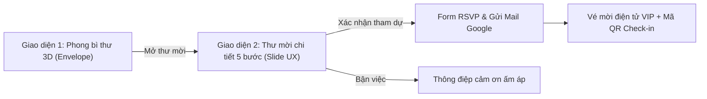

# 🎓 HỆ THỐNG THƯ MỜI & XÁC NHẬN THAM DỰ LỄ TỐT NGHIỆP ĐẠI HỌC (NIÊN KHÓA 2022 – 2026)
> **Fullstack Architecture: Spring Boot 3 (Java 17) + ReactJS (Vite, Tailwind CSS) + PostgreSQL / H2 Database + Google Mail SMTP**

Hệ thống thiệp mời tốt nghiệp điện tử đa nền tảng, tích hợp tính năng **sinh liên kết duy nhất cho từng khách mời lưu vào Database**, **trình chiếu từng phần theo con lăn chuột/click**, **phân luồng nội dung theo 3 nhóm đối tượng**, **sơ đồ bãi đỗ xe SVG tương tác**, và **hệ thống xác nhận tham dự (RSVP) tự động gửi email Google kèm vé mời điện tử**.

---

## 📑 MỤC LỤC
1. [Tổng Quan Trang Web Hiện Tại](#-1-tổng-quan-trang-web-hiện-tại)
2. [Trải Nghiệm Người Dùng (UX) Chuyển Mục Khi Lăn Chuột / Click](#-2-trải-nghiệm-người-dùng-ux-chuyển-mục-khi-lăn-chuột--click)
3. [Cơ Chế Liên Kết Duy Nhất & Quản Lý Database](#-3-cơ-chế-liên-kết-duy-nhất--quản-lý-database)
4. [Vai Trò & Cấu Trúc Phần Frontend](#-4-vai-trò--cấu-trúc-phần-frontend-frontend)
5. [Vai Trò & Cấu Trúc Phần Backend](#-5-vai-trò--cấu-trúc-phần-backend-backend)
6. [Cấu Trúc Cơ Sở Dữ Liệu (Database Schema)](#-6-cấu-trúc-cơ-sở-dữ-liệu-database-schema)
7. [Hướng Dẫn Khởi Chạy & Cấu Hình Môi Trường](#-7-hướng-dẫn-khởi-chạy--cấu-hình-môi-trường)

---

## 🌟 1. TỔNG QUAN TRANG WEB HIỆN TẠI

Hệ thống được thiết kế theo phong cách học thuật trang trọng (*Academic Luxury*) với bảng màu chủ đạo:
- **Xanh Navy Hoàng Gia (`#0F2342`)**: Thể hiện sự trang nghiêm, chững chạc của lễ tốt nghiệp đại học.
- **Vàng Champagne (`#C59B27`)**: Tôn vinh cột mốc thành công, màu của viền bằng và dải ruy băng cử nhân.
- **Màu Kem Giấy Da (`#FAF8F3`) & Trắng Ngà (`#FFFFFF`)**: Nền hoa văn giấy học thuật thanh lịch, dịu mắt.
- **Typography:** Kết hợp font có chân cổ điển `Playfair Display` và font không chân hiện đại `Be Vietnam Pro` (tối ưu hiển thị dấu tiếng Việt sắc nét trên mọi thiết bị).

### 2 Màn Hình Trải Nghiệm Chính:



#### ✉️ Giao diện 1: Phong bì thư tốt nghiệp 3D ([EnvelopeView.jsx](file:///d:/graduation/frontend/src/components/EnvelopeView.jsx))
- Mô phỏng phong thư với hiệu ứng 3D, dải viền nhũ vàng Champagne và viền chấm họa tiết học thuật.
- Hiển thị trực quan:
  - Danh hiệu: `CLASS OF 2026 • LỄ TỐT NGHIỆP ĐẠI HỌC`.
  - **Tên người được mời** (Recipient): Được cá nhân hóa tự động theo đường dẫn duy nhất.
  - **Tân Cử Nhân** (Host): `Hà Lê Tín - Chuyên ngành Công nghệ Thông tin`.
  - **Con dấu sáp vàng hoàng gia (Wax Seal)**: Chạm vào phong thư hoặc ấn con dấu với hiệu ứng mở nắp chuyển động mượt mà để dẫn vào nội dung thiệp mời.

#### 📜 Giao diện 2: Thư mời tương tác 5 phần ([InvitationLetterView.jsx](file:///d:/graduation/frontend/src/components/InvitationLetterView.jsx))
Trình bày đầy đủ 5 nội dung cốt lõi của lễ tốt nghiệp:
1. **Mục 01 - Mở đầu:** Biểu tượng Mũ Cử Nhân & Vòng Nguyệt Quế, lời chào trang trọng, khung vinh danh Tân Cử Nhân, thanh chỉ báo tiến trình 5 bước.
2. **Mục 02 - Lời ngỏ dành riêng:** Tâm thư cá nhân hóa riêng biệt theo 3 nhóm đối tượng (*Gia đình & Người thân*, *Bạn bè & Đồng môn*, *Thầy Cô & Hướng dẫn*) hoặc lời chúc riêng được lưu trong Database.
3. **Mục 03 - Thời gian & Địa điểm:** Lịch trình chi tiết đón tiếp ngoài sảnh & lễ trao bằng trong hội trường, nút lưu lịch sự kiện vào điện thoại (`.ICS`), địa chỉ trường và nút mở chỉ đường Google Maps.
4. **Mục 04 - Sơ đồ khuôn viên & Gửi xe:** Bản đồ vector SVG trực quan, tự động tô sáng bãi xe ô tô / nhà xe máy sinh viên / khu vực chụp ảnh theo nhóm khách mời.
5. **Mục 05 - Lời cảm ơn & Kết lại:** Lời tri ân chân thành, chữ ký cử nhân, số điện thoại hotline đón khách tại sảnh và nút lớn **Xác nhận tham dự (RSVP)**.

---

## 🖱️ 2. TRẢI NGHIỆM NGƯỜI DÙNG (UX) CHUYỂN MỤC KHI LĂN CHUỘT / CLICK

Nhằm mang lại trải nghiệm thuyết minh câu chuyện (*Storytelling Presentation*) ấn tượng, trang thiệp mời được xây dựng cơ chế chuyển slide tương tác đa phương thức:

* **Con lăn chuột (Mouse Wheel):**
  * Lăn xuống (Scroll Down): Tự động chuyển mượt mà sang mục kế tiếp (`01 ➔ 02 ➔ 03 ➔ 04 ➔ 05`).
  * Lăn lên (Scroll Up): Quay trở lại mục trước đó.
  * Tích hợp bộ đệm thời gian (*cooldown debounce 650ms*) ngăn hiện tượng cuộn lướt quá đà.
* **Nhấp chuột (Mouse Click):**
  * Nhấp chuột vào bất kỳ vị trí trống nào trên màn hình sẽ chuyển sang mục kế tiếp.
  * Các nút chức năng (*RSVP*, *Google Maps*, *Tải lịch .ICS*, *Gọi điện*) được cô lập sự kiện (`stopPropagation`), đảm bảo thực hiện đúng hành động mà không nhảy trang ngoài ý muốn.
* **Thanh tiến trình 5 bước cố định (Step Indicator):**
  * Đặt ở đầu trang, người xem có thể click trực tiếp vào bất kỳ bước nào (`01. Mở đầu`, `02. Lời mời`, `03. Địa điểm`, `04. Gửi xe`, `05. Cảm ơn`) để chuyển tức thì đến mục đó.
* **Thanh điều khiển cố định cuối trang (Bottom Navigation Bar):**
  * Gồm nút **"← Quay lại"**, **"Tiếp theo →"** và dãy **5 chấm tròn vị trí** hiển thị tiến trình trực quan.
* **Hỗ trợ Bàn phím & Thiết bị Cảm ứng:**
  * Dùng phím `↓`, `→`, `Spacebar`, `PageDown` để đi tới; `↑`, `←`, `PageUp` để lùi lại.
  * Hỗ trợ vuốt màn hình (Swipe Up / Swipe Down) trên điện thoại thông minh.

---

## 🔗 3. CƠ CHẾ LIÊN KẾT DUY NHẤT & QUẢN LÝ DATABASE

Mỗi khách mời nhận được một đường link cá nhân hóa độc nhất và lưu vĩnh viễn trong cơ sở dữ liệu:

```text
https://ten-mien-cua-ban.com/?code=bac-hai-8a2f
https://ten-mien-cua-ban.com/?code=thay-tuan
https://ten-mien-cua-ban.com/?code=hoi-ban-than-4k9p
```

1. **Thanh công cụ tạo link thông minh ([LinkBuilder.jsx](file:///d:/graduation/frontend/src/components/LinkBuilder.jsx)):**
   - Đặt nổi ở góc phải màn hình, hỗ trợ chọn nhóm đối tượng, nhập tên khách mời, tên cử nhân.
   - Mục mở rộng: Nhập lời chúc/tâm thư riêng và mã đường dẫn riêng (tự động sinh slug nếu để trống).
   - Đăng nhập quản trị trước, rồi bấm **"Tạo liên kết duy nhất & Lưu vào Database"**:
     - Gửi yêu cầu `POST /api/invitations` đến backend.
     - Backend chuẩn hóa tiếng Việt không dấu (VD: *"Bác Hai"* ➔ `bac-hai-8a2f`), kiểm tra trùng lặp và lưu vào bảng `invitations`.
     - Tự động sao chép đường dẫn duy nhất vào clipboard và hiển thị thông báo Toast.
2. **Bảng quản lý liên kết trong Database ([InvitationsListModal.jsx](file:///d:/graduation/frontend/src/components/InvitationsListModal.jsx)):**
   - Bấm nút **"Links (DB)"** để mở danh sách toàn bộ các liên kết đã tạo trong cơ sở dữ liệu.
   - Sao chép nhanh liên kết của bất kỳ ai, mở xem thử hoặc xóa liên kết cũ.
   - Các API quản lý danh sách và RSVP đều yêu cầu đăng nhập quản trị; chỉ ẩn nút trên giao diện không thay thế cho bảo vệ phía backend.

---

## 💻 4. VAI TRÒ & CẤU TRÚC PHẦN FRONTEND (`frontend/`)

Frontend được xây dựng bằng **ReactJS 18** và **Tailwind CSS v3**, đóng gói bằng **Vite** với hiệu năng cao, phản hồi nhanh dưới 100ms.

```text
frontend/src/
├── components/
│   ├── EnvelopeView.jsx              # Giao diện 1: Phong bì thư 3D sang trọng
│   ├── InvitationLetterView.jsx      # Giao diện 2: Thư mời 5 phần với UX cuộn/click
│   ├── CampusMap.jsx                 # Bản đồ khuôn viên trường dạng vector SVG tương tác
│   ├── LinkBuilder.jsx               # Thanh công cụ tạo link duy nhất & lưu Database
│   ├── InvitationsListModal.jsx      # Bảng quản lý danh sách liên kết đã lưu trong DB
│   ├── RsvpModal.jsx                 # Form điền thông tin xác nhận tham dự (RSVP)
│   ├── ConfirmationSuccessModal.jsx  # Vé mời điện tử VIP có mã QR & Check-in Code
│   ├── DeclineModal.jsx              # Modal cảm ơn khi khách bận không tham gia
│   └── AttendeesModal.jsx            # Quản lý danh sách khách phản hồi từ PostgreSQL
├── data/
│   └── graduationData.jsx            # Dữ liệu nội dung mẫu chi tiết của 3 nhóm khách
├── App.jsx                           # Component gốc điều phối trạng thái, URL & API
├── index.css                         # CSS tùy biến: Paper texture, elder-friendly, wax seal
└── main.jsx                          # Điểm khởi tạo ứng dụng React DOM
```

### Chi tiết vai trò từng Component:

| Component | Vai trò & Nhiệm vụ chính |
| :--- | :--- |
| **`App.jsx`** | Quản lý trạng thái màn hình (`ENVELOPE` / `LETTER`), đọc tham số URL (`?code=...`), tự động tải dữ liệu cá nhân hóa từ API Backend, quản lý đóng/mở tất cả các Modal, hiển thị thanh thông báo Toast. |
| **`EnvelopeView.jsx`** | Tạo ấn tượng ban đầu như nhận được bức thư thật. Hiển thị tên người nhận, tên cử nhân, con dấu sáp vàng với hiệu ứng xoay 3D và nắp phong bì chuyển động mở. |
| **`InvitationLetterView.jsx`** | Trái tim của giao diện mời: quản lý trạng thái 5 bước, lắng nghe sự kiện lăn chuột (`wheel`), nhấp chuột (`click`), phím mũi tên và vuốt cảm ứng để trình chiếu tuần tự các phần. |
| **`CampusMap.jsx`** | Sơ đồ khuôn viên trường Đại học Bách Khoa dạng SVG tinh xảo, nhận props `activeZone` (`car` / `bike` / `photo`) để tự động tô sáng bãi xe và khu vực đón tiếp tương ứng với nhóm khách. |
| **`LinkBuilder.jsx`** | Cho phép người dùng tùy biến thiệp, nhập lời chúc riêng và gọi API tạo liên kết độc nhất lưu vào cơ sở dữ liệu. |
| **`InvitationsListModal.jsx`** | Giao diện quản trị danh sách các thiệp mời đã lưu trong DB, cho phép sao chép link, xem trước và xóa thiệp. |
| **`RsvpModal.jsx`** | Form phản hồi lịch sự: lựa chọn tham dự/bận việc, số lượng người đi cùng, chọn khung giờ hẹn chụp ảnh kỷ yếu, nhập email để nhận vé mời qua Google Mail. |
| **`ConfirmationSuccessModal.jsx`** | Bắn pháo hoa chúc mừng (*Canvas Confetti*), hiển thị thẻ vé mời điện tử VIP gồm mã Check-in, thông tin buổi lễ và thông báo trạng thái gửi mail. |
| **`DeclineModal.jsx`** | Xử lý khi khách chọn *"Rất tiếc bận việc"* theo đúng tinh thần *"nếu không tham gia thì bỏ qua"*, gửi lời cảm ơn ấm áp và có nút cho phép đổi ý. |
| **`AttendeesModal.jsx`** | Bảng số liệu thống kê phản hồi thời gian thực: tổng lượt phản hồi, số người tham dự, số người từ chối, xuất xứ từ PostgreSQL. |
| **`graduationData.jsx`** | Kho nội dung được biên soạn chuẩn mực cho 3 nhóm đối tượng: Gia đình (lời lẽ hiếu kính, tri ân), Bạn bè (hóm hỉnh, trẻ trung), Thầy Cô (tôn sư trọng đạo, trang nhã). |

---

## ⚙️ 5. VAI TRÒ & CẤU TRÚC PHẦN BACKEND (`backend/`)

Backend được viết bằng **Java Spring Boot 3.3**, tuân thủ nghiêm ngặt **Java release 17** (Bytecode major version 61) để chạy ổn định trên mọi môi trường Java 17+ của hệ thống.

```text
backend/src/main/java/com/invitation/app/
├── config/
│   └── CorsConfig.java               # Cấu hình CORS cho phép React và Domain Cloud gọi API
├── controller/
│   └── InvitationController.java     # Cung cấp toàn bộ RESTful API Endpoints cho hệ thống
├── dto/
│   ├── CreateInvitationRequest.java  # DTO nhận yêu cầu tạo liên kết mới
│   ├── InvitationDto.java            # DTO trả về chi tiết thiệp mời cho Frontend
│   ├── RsvpRequest.java              # DTO tiếp nhận phản hồi tham dự từ khách mời
│   └── RsvpResponse.java             # DTO phản hồi kết quả và mã xác nhận check-in
├── entity/
│   ├── Attendee.java                 # JPA Entity ánh xạ bảng attendees (phản hồi khách)
│   └── Invitation.java               # JPA Entity ánh xạ bảng invitations (liên kết thiệp)
├── repository/
│   ├── AttendeeRepository.java       # Spring Data JPA Repository thao tác bảng attendees
│   └── InvitationRepository.java     # Spring Data JPA Repository thao tác bảng invitations
├── service/
│   ├── EmailService.java             # Dịch vụ gửi email HTML cao cấp qua Google Mail SMTP
│   └── InvitationService.java        # Nghiệp vụ sinh mã slug duy nhất, lưu DB và xử lý RSVP
└── InvitationApplication.java        # Main Entrypoint khởi chạy Spring Boot
```

### Chi tiết vai trò từng thành phần Backend:

| Thành phần | Vai trò & Xử lý nghiệp vụ |
| :--- | :--- |
| **`InvitationController.java`** | Tiếp nhận và điều hướng các yêu cầu HTTP:<br>• `GET /api/invitation?code={code}`: Lấy thông tin thiệp theo mã slug.<br>• `GET /api/invitations`: Lấy toàn bộ danh sách liên kết (quản trị).<br>• `POST /api/invitations`: Tạo mới và lưu liên kết duy nhất (quản trị).<br>• `DELETE /api/invitations/{id}`: Xóa liên kết (quản trị).<br>• `POST /api/invitation/rsvp`: Tiếp nhận phản hồi tham dự.<br>• `GET /api/invitation/attendees`: Thống kê khách mời (quản trị). |
| **`InvitationService.java`** | Chứa logic nghiệp vụ cốt lõi:<br>• `generateUniqueSlug(name)`: Thuật toán chuyển tên có dấu thành slug không dấu và thêm hậu tố ngẫu nhiên nếu trùng.<br>• Tự động nạp sẵn dữ liệu mẫu vào DB khi khởi chạy lần đầu.<br>• Quản lý lưu trữ thông tin phản hồi và kích hoạt gửi email. |
| **`EmailService.java`** | Kết nối máy chủ `smtp.gmail.com:587` qua giao thức STARTTLS. Tạo template email định dạng HTML chuẩn với phong cách Navy & Champagne, nhúng mã check-in, khung giờ chụp ảnh và hướng dẫn đỗ xe gửi trực tiếp vào hộp thư Google của khách. |
| **Cấu hình 2 Profile linh hoạt** | • **Profile `dev` (Mặc định):** Sử dụng In-Memory H2 Database, khởi động tức thì không cần cài đặt DB.<br>• **Profile `prod`:** Sử dụng PostgreSQL chuyên dụng cho môi trường Cloud khi có connection string. |

---

## 🗄️ 6. CẤU TRÚC CƠ SỞ DỮ LIỆU (DATABASE SCHEMA)

Hệ thống sử dụng 2 bảng chính được định nghĩa trong [schema.sql](file:///d:/graduation/backend/src/main/resources/schema.sql):

### 1. Bảng `invitations` (Lưu trữ liên kết thiệp mời duy nhất)
| Tên cột | Kiểu dữ liệu | Ràng buộc | Mô tả |
| :--- | :--- | :--- | :--- |
| `id` | BIGSERIAL | PRIMARY KEY | Khóa chính tự tăng |
| `code` | VARCHAR(100) | UNIQUE, NOT NULL | Mã liên kết độc nhất (URL slug: `bac-hai-8a2f`) |
| `recipient_name` | VARCHAR(255) | NOT NULL | Tên người nhận thiệp |
| `sender_name` | VARCHAR(255) | DEFAULT 'Hà Lê Tín' | Tên Tân Cử Nhân |
| `guest_group` | VARCHAR(50) | DEFAULT 'family' | Phân loại nhóm: `family`, `friends`, `mentors` |
| `custom_message` | TEXT | NULLABLE | Lời chúc/tâm thư riêng biệt lưu cho liên kết này |
| `event_title` | VARCHAR(255) | | Tiêu đề buổi lễ |
| `event_date` | VARCHAR(100) | | Ngày tổ chức (`22/11/2026`) |
| `event_time` | VARCHAR(100) | | Giờ tổ chức (`09:30 – 12:30`) |
| `event_venue` | VARCHAR(255) | | Địa điểm tổ chức (Hội trường Lớn) |
| `event_address` | VARCHAR(255) | | Địa chỉ khuôn viên trường |
| `created_at` | TIMESTAMP | DEFAULT CURRENT_TIMESTAMP | Thời gian tạo liên kết |

### 2. Bảng `attendees` (Lưu trữ phản hồi xác nhận tham gia RSVP)
| Tên cột | Kiểu dữ liệu | Ràng buộc | Mô tả |
| :--- | :--- | :--- | :--- |
| `id` | BIGSERIAL | PRIMARY KEY | Khóa chính tự tăng |
| `full_name` | VARCHAR(255) | NOT NULL | Họ và tên khách phản hồi |
| `email` | VARCHAR(255) | NOT NULL | Email Google nhận vé mời điện tử |
| `phone` | VARCHAR(50) | NULLABLE | Số điện thoại liên hệ đón tại cổng |
| `attending` | BOOLEAN | DEFAULT TRUE | Trạng thái: `true` (Sẽ đến) / `false` (Bận việc) |
| `guests_count` | INT | DEFAULT 1 | Số lượng khách đi cùng (dạng số) |
| `guests_count_desc`| VARCHAR(100) | | Mô tả số lượng (VD: `3 - 4 người (Gia đình)`) |
| `guest_group` | VARCHAR(50) | | Nhóm khách mời |
| `photo_slot` | VARCHAR(255) | | Khung giờ hẹn chụp ảnh cùng cử nhân |
| `grad_name` | VARCHAR(255) | | Tên cử nhân đón tiếp |
| `notes` | TEXT | NULLABLE | Lời nhắn / yêu cầu hỗ trợ bãi đỗ xe |
| `confirmation_code`| VARCHAR(100) | UNIQUE | Mã vé Check-in điện tử (VD: `GRAD-2026-A1B2C3D4`) |
| `email_sent` | BOOLEAN | DEFAULT FALSE | Trạng thái gửi mail Google thành công hay chưa |
| `created_at` | TIMESTAMP | DEFAULT CURRENT_TIMESTAMP | Thời điểm khách gửi phản hồi |

---

## 🚀 7. HƯỚNG DẪN KHỞI CHẠY & CẤU HÌNH MÔI TRƯỜNG

### Cách 1: Khởi chạy nhanh 1-Click bằng Script (Khuyên dùng khi chạy local)
Thư mục gốc đã được trang bị sẵn 2 file thực thi tự động:
1. **Khởi động Backend:** Nhấp đúp vào [start-backend.bat](file:///d:/graduation/start-backend.bat) (Tự động nhận diện Java 17, khởi động Spring Boot tại cổng `8088`).
2. **Khởi động Frontend:** Nhấp đúp vào [start-frontend.bat](file:///d:/graduation/start-frontend.bat) (Tự động nhận diện NodeJS, khởi động Vite dev server tại `http://localhost:5173`).

#### Tài khoản quản trị
Sao chép `.env.example` thành `.env` rồi điền thông tin riêng; không commit `.env` lên GitHub. Đặt `ADMIN_USERNAME` và `ADMIN_PASSWORD` trước khi khởi động backend. Không dùng mật khẩu mặc định hoặc lưu thông tin này trong mã nguồn. Ví dụ PowerShell:
```powershell
$env:ADMIN_USERNAME = "admin"
$env:ADMIN_PASSWORD = "<mat-khau-manh-rieng-cua-ban>"
.\start-backend.bat
```
Trong Docker, khai báo hai biến này trong `.env` cạnh `docker-compose.yml` trước khi chạy compose. Backend khóa các API quản trị nếu thiếu cấu hình. Mở trang chính sẽ hiển thị màn hình đăng nhập quản trị; xác thực Basic chỉ được giữ trong bộ nhớ của tab và cần đăng nhập lại sau khi tải lại trang. Các link thiệp mời có mã khách (`?code=...`) vẫn truy cập công khai. Chỉ gửi thông tin xác thực qua HTTPS khi triển khai công khai.

---

### Cách 2: Mở xem trực tiếp không cần cài đặt phần mềm
Nhấp đúp chuột mở trực tiếp file [preview.html](file:///d:/graduation/preview.html) để xem bản trình diễn giao diện thiệp. Đăng nhập quản trị và các thao tác lưu link vào Database cần chạy ứng dụng bằng Vite hoặc Docker Compose.

---

### Cách 3: Khởi chạy bằng Docker & Docker Compose
Hệ thống cung cấp sẵn [docker-compose.yml](file:///d:/graduation/docker-compose.yml), [Dockerfile.backend](file:///d:/graduation/Dockerfile.backend) và [Dockerfile.frontend](file:///d:/graduation/Dockerfile.frontend):

Dockerfile backend tự build JAR bằng Maven từ mã nguồn; không cần commit hoặc chuẩn bị sẵn thư mục `backend/target`.

```bash
docker compose up -d --build
```
- **Frontend Nginx:** Lắng nghe tại cổng `3000` (truy cập `http://localhost:3000`).
- **Spring Boot Backend:** Lắng nghe tại cổng `8088`.
- **PostgreSQL Database:** Lắng nghe tại cổng `5434` trên máy host.

Khi deploy frontend và backend thành hai dịch vụ riêng, đặt biến `API_UPSTREAM` của frontend bằng URL public của backend (ví dụ `https://<backend-domain>`), không thêm `/api` ở cuối. Giá trị mặc định `http://backend:8088` chỉ dùng khi cả hai chạy cùng Docker Compose.

Nếu dùng PostgreSQL Aiven, backend phải dùng đúng JDBC URL, username và password trong trang connection information của Aiven. Hostname `postgres` chỉ tồn tại trong mạng nội bộ Docker Compose, không dùng được khi backend deploy độc lập.

---

### Cách 4: Cấu hình Cloud PostgreSQL & Google Mail SMTP

#### 1. Cấu hình Cloud PostgreSQL (Supabase, Neon.tech, Render, Railway, AWS RDS):
Chỉ cần điền chuỗi kết nối vào file `application-prod.properties` hoặc thiết lập biến môi trường hệ thống:
```properties
SPRING_PROFILES_ACTIVE=prod
SPRING_DATASOURCE_URL=jdbc:postgresql://<HOST_CLOUD>:5432/<DB_NAME>?sslmode=require
SPRING_DATASOURCE_USERNAME=<USERNAME>
SPRING_DATASOURCE_PASSWORD=<PASSWORD>
```

#### 2. Cấu hình gửi mail Google xác nhận (Gmail SMTP):
Tạo **Mật khẩu ứng dụng (App Password)** 16 ký tự tại [Google Account Security](https://myaccount.google.com/apppasswords), sau đó cấu hình:
```properties
GOOGLE_MAIL_USERNAME=email_cua_ban@gmail.com
GOOGLE_MAIL_PASSWORD=chuoi_16_ky_tu_app_password
```
*(Nếu chưa cấu hình tài khoản Google, hệ thống vẫn lưu dữ liệu phản hồi vào Database an toàn và hiển thị vé mời điện tử trên màn hình mà không bao giờ bị dừng hoạt động).*

---
*Dự án hoàn thiện cho Lễ Tốt Nghiệp Đại Học • Niên Khóa 2022 – 2026.*
